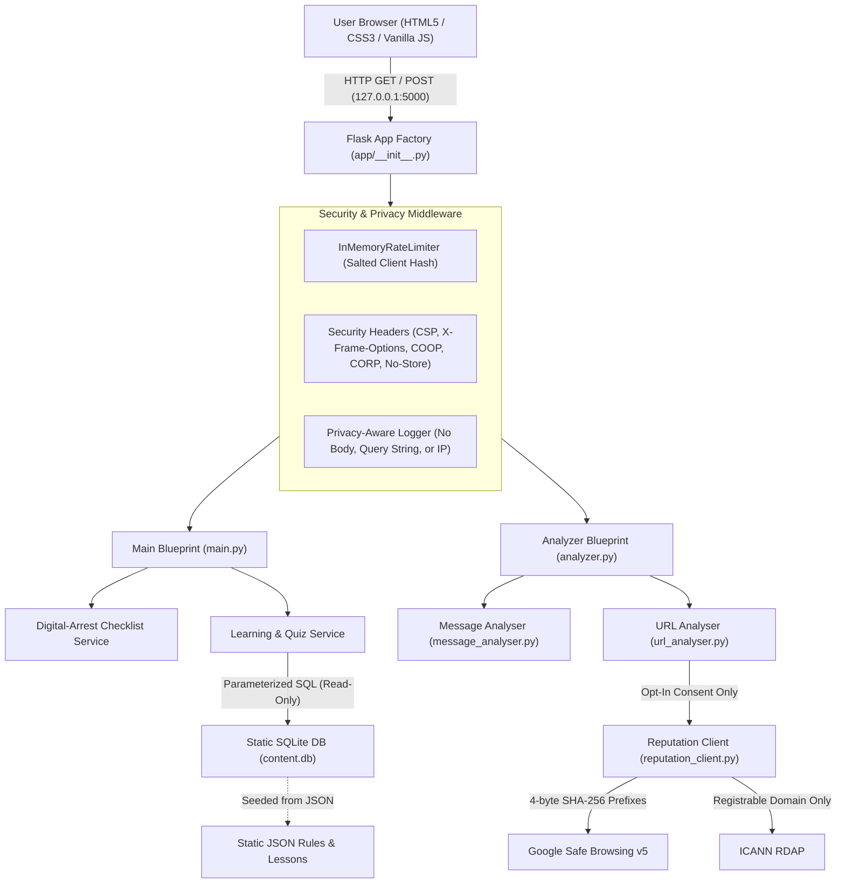
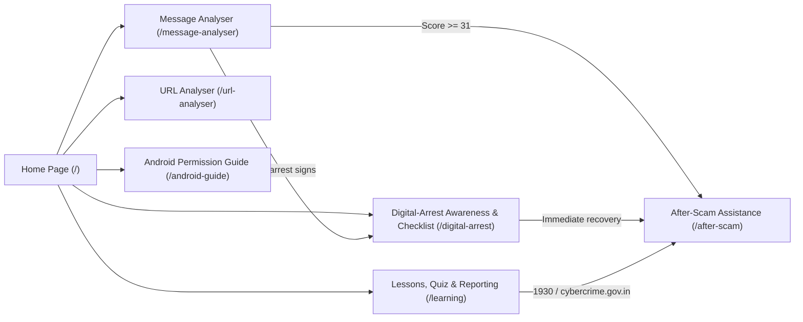
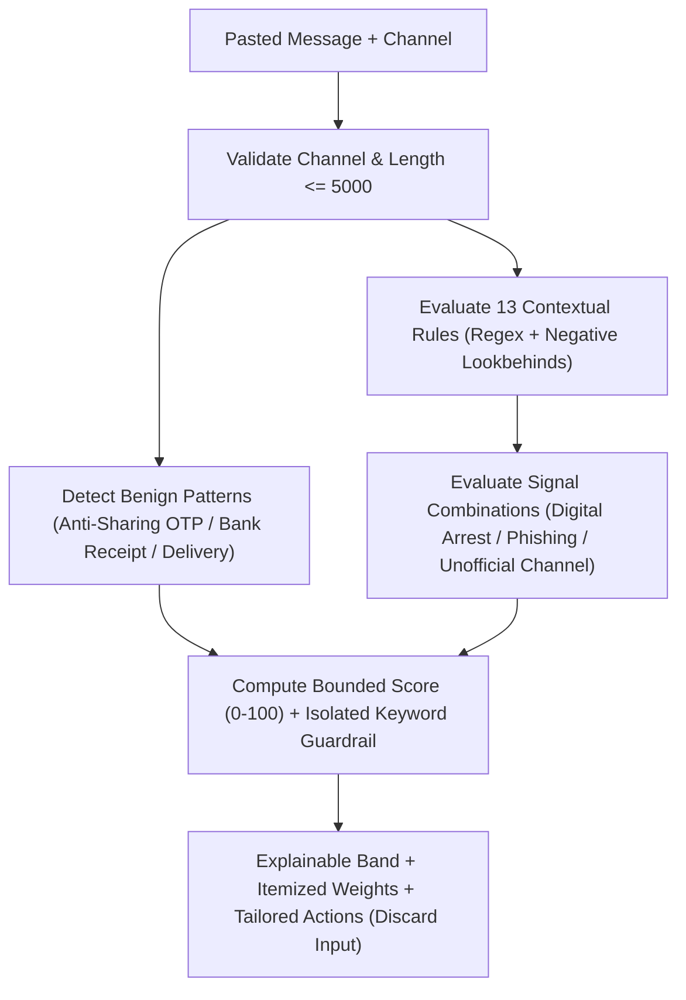
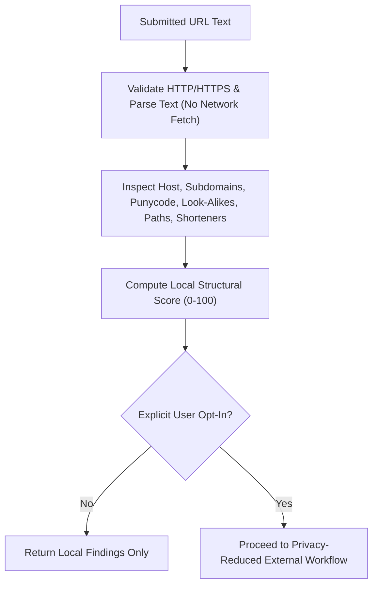
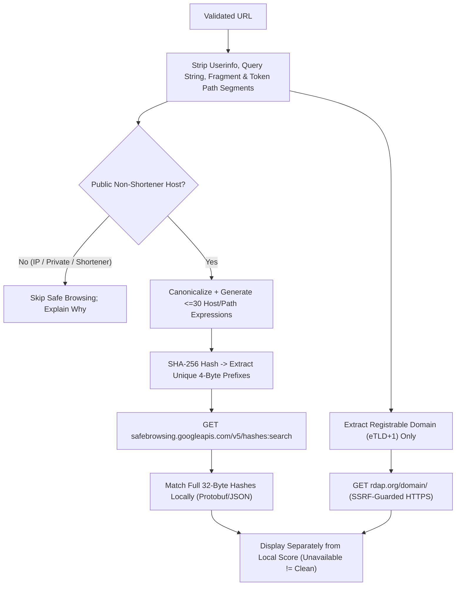

# Final Project Report

**Project Title:** Cybersecurity Awareness Platform for Phishing, Digital Arrest Scams, and Malicious Applications  
**Institution:** RNS Institute of Technology, Department of Computer Science and Engineering  
**Course:** Community Project Work (`25BCBPR308`) — Section B, Batch No. 10  
**Team Members:**
- Darshan A (`1IB25CS052`)
- H Shashank Sharma (`1IB25CS069`)
- Swastik Katyayan (`1IB25CS220`)
- Sandeep Gowda D V (`1IB25CS187`)  
**Internal Guide:** Mrs. Mamatha Jaijur S, Assistant Professor, Dept. of CSE  

---

## 1. Project Introduction

Phishing messages, deceptive URLs, and impersonation scams exploit human trust, artificial urgency, and fear. In India, "digital-arrest" scammers impersonate police, CBI, customs, RBI, or telecom officials, isolate victims on continuous video calls, forbid them from contacting family, and demand transfers to supposed "safe" or "verification" accounts [6, 7]. Alongside these social-engineering attacks, malicious Android applications distributed outside official app stores often abuse sensitive permissions such as Accessibility access, Notification access, Display over other apps, and Install unknown apps [3].

This project delivers a responsive, locally runnable, privacy-conscious cybersecurity awareness web platform built with HTML5, CSS3, Vanilla JavaScript, Python, and Flask. It explains warning signs in plain language rather than issuing opaque verdicts, inspects messages and URLs strictly in memory, and provides an interactive digital-arrest call checklist, calm non-blaming after-scam recovery steps, Android special-access guidance, scenario-based lessons, and interactive quizzes.

> **Advisory Principle:** Every analysis output is strictly advisory. `"No known red flags"` is never proof that a message, URL, caller, or application is safe.

---

## 2. Problem Statement

General public users lack a single accessible, privacy-conscious workflow to:
1. Understand *why* a pasted SMS, WhatsApp message, or email looks suspicious without sending private conversations to external servers.
2. Inspect suspicious HTTP/HTTPS links structurally without clicking or visiting them.
3. Recognise psychological digital-arrest coercion (fear, authority, urgency, secrecy, video-call pressure) and act calmly if targeted.
4. Understand sensitive Android permissions without relying on misleading "permission = malware" claims.
5. Reach verified Indian cybercrime reporting channels (`1930`, `cybercrime.gov.in`, `cert-in.org.in`) quickly in one unified interface.

---

## 3. Objectives

1. Develop a responsive, accessible public-awareness web platform with calm, non-blaming guidance (`WCAG 2.2 AA`-aligned design practices).
2. Identify phishing and digital-arrest indicators through contextual rule combinations while minimising false positives on genuine bank, UPI, OTP, and delivery alerts.
3. Inspect URL structures (IP hosts, misleading subdomains, punycode/look-alikes, shorteners, obfuscated paths) without opening, fetching, or expanding links; perform external reputation lookups only with explicit user consent and privacy-reduced indicators.
4. Present explainable `0–100` advisory scores in three bands (`0–30: No known red flags`, `31–65: Some warning signs`, `66–100: Strong scam signs`) with itemized indicator explanations and recommended actions.
5. Provide an interactive digital-arrest call checklist, ordered after-scam recovery steps, Android special-access guidance, short lessons/quizzes backed by static SQLite/JSON content, and official reporting links.
6. Protect submitted data through in-memory processing, privacy-aware logging, strict security headers, rate limiting, and input validation.
7. Prepare a structured detection evaluation pipeline targeting 300+ de-identified messages and a consent-based 20–30 participant usability study workflow.

---

## 4. Literature Survey Summary

- **SMS Spam & Smishing Detection:** Al Saidat et al. [1] and Wilk-Jakubowski et al. [9] survey rule-based, NLP, and ML phishing detection methods; Popescul & Radu [10] review AI phishing detection trends. Rules were chosen for this public awareness prototype because every warning can be explained transparently without requiring a large proprietary training corpus.
- **Malicious-URL Detection:** Tian et al. [2] survey URL features, datasets, and evaluation pitfalls, informing structural inspection of IP hosts, subdomains, look-alikes, punycode, and obfuscated paths.
- **Android Permissions:** Pathak et al. [3], Sharma & Arora [14], and Maganur et al. [13] study Android permissions for malware research; this platform strictly limits itself to educational permission guidance and never classifies APKs as malware.
- **Cybersecurity Awareness & Training:** Le-Nye et al. [4] compare educational and game-based phishing awareness, while Ho et al. [5] show standard training alone has limited behavioural durability—supporting short, scenario-based interactive lessons and quizzes evaluated with users.
- **Digital-Arrest Fraud & Official Guidance:** Pandey & Parashar [6], Robert et al. [11] (three-stage psychological framework: initiation, manipulation, compliance), and Upadhyay [12] examine digital-arrest coercion, corroborated by I4C Advisory `TAU/ADV/003` [7] and CERT-In Advisory `CIAD-2024-0050` [8].

---

## 5. Existing System and Limitations

| Existing System | How It Works | Documented Limitations |
| :--- | :--- | :--- |
| Spam filters (e.g., Google Messages, Truecaller) [1] | Filter incoming SMS/email automatically | Partial protection; rarely explain message-level coercion cues to users |
| Browser/URL reputation warnings (e.g., Safe Browsing) [2] | Warn or block known malicious links | Depend on feed freshness; warn without teaching URL inspection skills |
| Mobile security apps / permission viewers [3] | Scan APKs or list requested permissions | Permission presence alone cannot establish malicious intent; disconnected from scam education |
| Official advisories (I4C, CERT-In) [7, 8] | Publish PDF/web scam alerts and helplines | Separate from interactive message/URL checking tools |

---

## 6. Proposed System

The platform integrates explainable message inspection, text-only URL analysis, opt-in privacy-reduced external checks, a digital-arrest call checklist, calm after-scam recovery steps, Android special-access explanations, and scenario-based lessons/quizzes into one lightweight, self-hosted Flask web application.

---

## 7. System Architecture

---

## 8. Technology Stack

- **Frontend:** HTML5, CSS3, Vanilla JavaScript (zero external CDNs, fonts, or JS frameworks)
- **Backend:** Python 3.14, Flask 3.1.3, python-dotenv 1.2.4, Requests 2.34.2, publicsuffix2 2.20191221 (offline Mozilla Public Suffix List)
- **Storage:** SQLite (`app/database/content.db`) + JSON (`app/database/*.json`) for static content only
- **Testing & Evaluation:** pytest 9.2.0, custom Python evaluation/splitting scripts (`evaluation/`)
- **External APIs (Opt-In Only):** Google Safe Browsing API v5 (`hashes:search`), ICANN RDAP (`rdap.org`)

---

## 9. Methodology & Application Workflow

---

## 10. Message Analysis Engine

The engine (`app/services/message_analyser.py`, `app/database/message_rules.json`) normalizes whitespace in memory, checks channel (`sms`, `whatsapp`, `email`) and size caps (`<= 5000` chars), evaluates 13 weighted indicator rules (impersonation, arrest threats, legal intimidation, secrecy, video-call pressure, safe-account demands, payment demands, OTP/password requests, sensitive info/remote access, strong urgency, mild urgency, isolated OTP, link/contact), applies contextual combination bonuses (`combo_digital_arrest`, `combo_credential_phishing`, `combo_unofficial_channel_coercion`), and subtracts benign-context offsets (`benign_protective_otp`, `benign_bank_upi_receipt`, `benign_delivery_update`) when coercive signals are absent.

---

## 11. URL Analysis Engine

The URL analyser (`app/services/url_analyser.py`, `app/database/url_rules.json`) parses `http://` and `https://` inputs strictly as text (`<= 2048` chars) without opening links, following redirects, or expanding shorteners. It inspects IPv4/hex/octal/shorthand/IPv6 hosts, `@` userinfo tricks, punycode (`xn--`), brand-in-subdomain spoofing, look-alike/leet-speak domains, excessive subdomains, high-abuse TLDs, `.apk` links, suspicious path keywords, obfuscated encoding, non-standard ports, and URL shorteners (`Destination not verified`).

---

## 12. External API Integrations (Privacy-Conscious Workflow)

---

## 13. Digital-Arrest Awareness & After-Scam Module

- `/digital-arrest` explains government/police/CBI impersonation, arrest threats, video-call surveillance, secrecy, safe-account scams, and the 3-stage psychological manipulation cycle [11], paired with a stateless 7-item interactive call checklist (`digital_arrest_service.py`).
- `/after-scam` presents calm, non-blaming guidance (`"You are not to blame."`) with the six ordered recovery steps verified against I4C/CERT-In guidance: (1) Call `1930`, (2) File at `cybercrime.gov.in`, (3) Contact bank immediately, (4) Preserve transaction records, (5) Retain messages/evidence, (6) Follow up officially.

---

## 14. Android Permission Guidance

- `/android-guide` covers **Accessibility access**, **Notification access**, **Display over other apps**, and **Install unknown apps**—explaining what each does, legitimate uses, possible abuse, precautions, and exact Android Settings paths, plus an educational context helper.
- No APK upload, execution, or malware classification is performed; permission presence alone is never treated as proof of malice.

---

## 15. Learning and Quiz Module

- `/learning` serves 6 fictional scenario-based lessons (phishing, suspicious URLs, digital arrest, OTP/UPI safety, permission abuse, cybercrime reporting) and an 8-question multiple-choice quiz with instant scoring, per-question explanations, and retry support, backed by static SQLite tables (`app/database/content.db`) seeded from JSON.

---

## 16. Privacy and Security Measures

Detailed in [PRIVACY_AND_SECURITY.md](PRIVACY_AND_SECURITY.md) and [SECURITY_AUDIT_PHASE6.md](SECURITY_AUDIT_PHASE6.md):
- Transient in-memory processing of messages and URLs; zero database/file/log retention of user inputs.
- Parameterized SQLite queries exclusively on static educational tables.
- Strict CSP (`default-src 'self'`), `X-Frame-Options: DENY`, `Referrer-Policy: no-referrer`, `COOP`, `CORP`, `Cache-Control: no-store`, `DEBUG = False`, `InMemoryRateLimiter` (`429`), payload caps (`64 KB`, `5000` chars, `2048` chars), and RDAP SSRF protections.

---

## 17. Testing Methodology

- Automated pytest suite (`tests/test_phase1_app.py` through `tests/test_phase7_end_to_end.py`) covering unit logic, routes, false-positive edge cases, mocked Safe Browsing protobuf/JSON and RDAP error paths, privacy/logging guarantees, XSS escaping, rate limiting, and end-to-end flows.
- Evaluation pipeline (`evaluation/split_dataset.py` and `evaluation/evaluate_detection.py`) enforcing two-annotator labelling, Cohen's kappa, template-grouped 70/30 splitting, frozen rules SHA-256 verification, and comparison against a keyword-only baseline.

---

## 18. Actual Detection Evaluation Results

- **Genuine 300+ Held-Out Dataset Evaluation:** **PENDING — Genuine dataset evaluation not yet conducted.** (Requires external collection, redaction, and independent two-annotator labelling of 300+ genuine de-identified messages including 100+ genuine benign bank/UPI/delivery notifications.)
- **Synthetic Development Smoke Verification (`evaluation/synthetic_smoke_samples.csv`, `--mode synthetic-smoke`, 24 `synthetic_dev` messages only — blocked from `genuine-eval` and not a substitute for the 300+ genuine dataset):**
  - Frozen rules SHA-256: `a74d118faa722a13c2365d83808073a4f365b30883d79bd7499554be3d6e11b1`
  - **Contextual Rule Engine (`threshold=31`):** `TP=12, FP=0, TN=12, FN=0` | Precision `1.0` | Recall `1.0` | F1 `1.0` | Macro-F1 `1.0` | Weighted-F1 `1.0` | FPR `0.0` | FNR `0.0` | Avg response `0.275 ms` (`p95=0.1489 ms`).
  - **Keyword-Only Baseline:** `TP=12, FP=9, TN=3, FN=0` | Precision `0.5714` | Recall `1.0` | F1 `0.7273` | Macro-F1 `0.5636` | Weighted-F1 `0.5636` | FPR `0.75` | FNR `0.0`.
  - **Template-Grouped 70/30 Split:** `Dev=16`, `Test=8` (zero `template_group_id` or duplicate-text leakage), Cohen's kappa `1.0` on synthetic annotations.

---

## 19. Actual Usability Study Results

- **20–30 Participant Voluntary Usability Evaluation:** **PENDING — Participant usability study not yet conducted.** Protocol, informed consent notice, 5 fictional scenario tasks, and anonymous questionnaire template are ready in `evaluation/USABILITY_STUDY_PROTOCOL.md` and `evaluation/usability_questionnaire_template.csv`.

---

## 20. Limitations

1. English-only prototype; regional Indian languages (Hindi, Kannada) and code-mixed messages are future work.
2. Rule-based scoring (`0–100`) is advisory, not a calibrated probability, and may miss novel phishing phrasing.
3. Shortened URLs are never expanded and remain `"Destination not verified"`.
4. Live Google Safe Browsing v5 lookups require a valid non-commercial `SAFE_BROWSING_API_KEY` and network access; unavailable feeds are reported as `"Reputation information unavailable"`.
5. No APK binary scanning, live call intervention, or WhatsApp integration.
6. 300+ genuine dataset evaluation and 20–30 participant usability testing remain pending human execution.

---

## 21. Expected and Observed Outcomes

- **Observed:** A fully runnable local Flask application with 7 integrated web pages, JSON APIs, explainable scoring, opt-in Safe Browsing v5 + RDAP clients, static SQLite/JSON educational content, security headers, rate limiting, automated tests, and evaluation scripts.
- **Pending:** Empirical held-out metrics on 300+ genuine messages and anonymous usability feedback from 20–30 voluntary participants.

---

## 22. Conclusion

The Cybersecurity Awareness Platform demonstrates that transparent, rule-based phishing and digital-arrest detection can be combined with text-only URL analysis, privacy-reduced external checks, calm post-scam recovery guidance, and scenario-based learning in a lightweight, privacy-conscious local web application. Completing the genuine dataset annotation and voluntary user study will provide the empirical validation needed for final submission.

---

## 23. References

[1] M. R. Al Saidat, S. Y. Yerima, and K. Shaalan, "Advancements of SMS Spam Detection: A Comprehensive Survey of NLP and ML Techniques," *Procedia Computer Science*, vol. 244, pp. 248–259, 2024.  
[2] Y. Tian, Y. Yu, J. Sun, and Y. Wang, "From past to present: A survey of malicious URL detection techniques, datasets and code repositories," *Computer Science Review*, vol. 58, Art. 100810, 2025.  
[3] A. Pathak, T. S. Kumar, and U. Barman, "Static analysis framework for permission-based dataset generation and android malware detection using machine learning," *EURASIP Journal on Information Security*, vol. 2024, Art. 33, 2024.  
[4] E. N. M. Le-Nye, C. Yaacoub, and J. Possik, "Evaluating Phishing Awareness Strategies: A Comparative Study of Education-based Approaches and Game-based Learning," *Procedia Computer Science*, vol. 251, pp. 666–671, 2024.  
[5] G. Ho et al., "Understanding the Efficacy of Phishing Training in Practice," in *Proc. IEEE Symp. Security and Privacy*, 2025, pp. 37–54.  
[6] S. K. Pandey and A. Parashar, "Navigating Digital Arrest under India's Cyber-Forensics Framework: Complexities, Legal Gaps, and Pathways Forward," *NFSU Journal of Forensic Justice*, vol. 4, no. 1, pp. 80–89, Jan.–Jun. 2025.  
[7] I4C, Ministry of Home Affairs, "Digital Arrest Scam," Advisory TAU/ADV/003, 6 Mar. 2025, `cybercrime.gov.in`.  
[8] CERT-In, "Preventing Online Scams," Advisory CIAD-2024-0050, 24 Oct. 2024, `cert-in.org.in`.  
[9] Google Safe Browsing, "Safe Browsing API v5 Overview" and "Method: hashes.search," `developers.google.com/safe-browsing/reference`.  
[10] Google Safe Browsing, "Terms of Service," `developers.google.com/safe-browsing/terms`.  
[11] S. J. Robert, V. Singh, R. P. Pandey, and B. Bhuyan, "Digital arrest in the cyber age: a psychological perspective on fear, authority, and consciousness," *Frontiers in Psychology*, vol. 17, Art. 1726740, 2026.  
[12] A. H. Upadhyay, "Contours and Webs of Digital Arrest Pandemic," *Journal of Communications Finance*, vol. II, no. II, pp. 44–49, Jul.–Dec. 2025.  
[13] S. Maganur, Y. Jiang, J. Huang, and F. Zhong, "Feature-Centric Approaches to Android Malware Analysis: A Survey," *Computers*, vol. 14, no. 11, Art. 482, 2025.  
[14] Y. Sharma and A. Arora, "A comprehensive review on permissions-based Android malware detection," *Int. J. Inf. Secur.*, vol. 23, no. 3, pp. 1877–1912, 2024.  
[15] W3C, "Web Content Accessibility Guidelines (WCAG) 2.2," W3C Recommendation, 12 Dec. 2024, `w3.org/TR/WCAG22/`.
