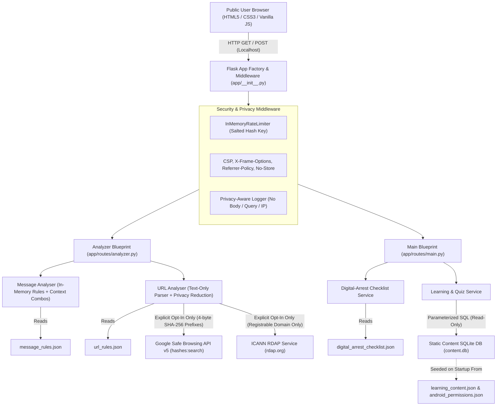

# Project Architecture

## 1. Architectural Overview

The platform uses a lightweight modular Flask MVC/service architecture designed for local Linux execution, strict input transience, and clear separation between static educational content, in-memory local analysis, and opt-in privacy-reduced external checks.

## 2. Module Responsibilities

- **`config.py`**: Loads `.env`, enforces `DEBUG = False` by default, sets payload limits (`MAX_CONTENT_LENGTH`, `MAX_MESSAGE_LENGTH`, `MAX_URL_LENGTH`), rate-limit defaults, and server-side API credentials.
- **`app/__init__.py`**: Creates the Flask app, initializes static SQLite content, enforces rate limiting on `POST` routes, attaches security headers, configures privacy-aware logging, and provides generic error handlers (`400`, `404`, `405`, `413`, `429`, `500`).
- **`app/routes/`**:
  - `main.py`: `/`, `/digital-arrest`, `/api/digital-arrest-checklist`, `/after-scam`, `/android-guide`, `/learning`, `/api/quiz/submit`, `/health`.
  - `analyzer.py`: `/message-analyser`, `/api/analyze-message`, `/url-analyser`, `/api/analyze-url`.
- **`app/services/`**:
  - `message_analyser.py`: Contextual weighted rule engine combining indicator rules, combination bonuses, and benign-context false-positive offsets.
  - `url_analyser.py`: Text-only structural URL parser, canonicalizer, offline Mozilla PSL registrable-domain extractor (`publicsuffix2`), Safe Browsing expression generator, and privacy-reduction sanitizer.
  - `reputation_client.py`: Safe Browsing v5 binary protobuf/JSON decoder and SSRF-guarded registrable-domain RDAP client.
  - `digital_arrest_service.py`: Stateless call-checklist evaluator.
  - `learning_service.py`: Stateless quiz grader and educational Android permission helper.
  - `rate_limiter.py`: Thread-safe sliding-window limiter using ephemeral salted hashes.
- **`app/database/`**:
  - `content_store.py`: Seeds and queries `content.db` using parameterized SQL for static tables (`android_permissions`, `lessons`, `quiz_questions`) only.
  - `*.json`: Static rules, lessons, quiz items, checklist items, and permission explanations.

## 3. Data Flow & Transience

1. **Message & URL Inputs:** Held strictly in local Python variables for the duration of a single HTTP request, then discarded. Never persisted to SQLite, disk, sessions, or logs.
2. **Static Content:** Seeded deterministically from repository JSON files into `app/database/content.db` on app startup.
